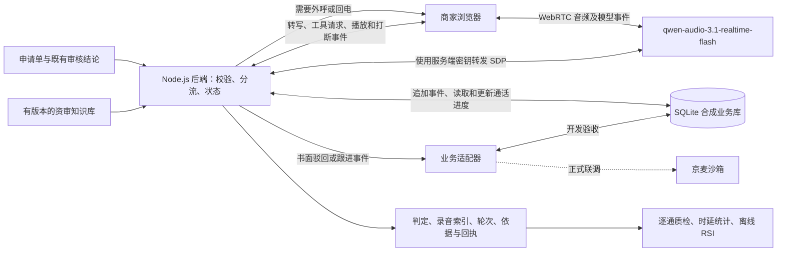

# 智语外呼 · POP 商家资审驳回的实时对话与办理架构

本文是开发和验收设计。业务起点是一张**已有审核结论**的京东开放平台（POP）申请单，涉及商家入驻、新增经营品牌或新增类目。系统按资审场景决定如何告知商家。需要外呼时，AI 核实商家身份，解释材料哪里有问题、如何整改，回答追问，再由后端向京麦提交书面意见。审核结论由业务系统提供，商家表示听明白只代表告知情况，后续是否通过取决于重新审核。

第一阶段默认使用百炼 Qwen-Audio-3.1-Realtime 的 Flash 型号 `qwen-audio-3.1-realtime-flash`。它在浏览器里与商家实时对话、接收插话并请求业务工具。Node.js 后端负责分流、核身、查询知识、保存通话进度和向京麦回写。第二阶段固定该型号、提示词和工具定义，利用失败案例离线优化后端策略。以下业务工具都是团队拟定的接口，正式沙箱的地址、鉴权、字段和回执格式有待联调。开发使用合成申请单和本地适配器，通话仅在模拟浏览器中进行。[Flash 型号说明](https://help.aliyun.com/en/model-studio/qwen-audio-3-1-realtime-flash)

赛题排名门槛包括浏览器内连续至少三轮实时语音交互、端到端首字响应时延 P50 ≤ 2 秒、至少一项完整外呼闭环和零严重合规违规。下文的测试矩阵和发布条件属于团队自测设计。评审材料须能从结果追溯至原始日志、实验记录和对比数据。[赛题简介及规则](https://bjcsaiic.zsyqkj.com/topics/2026/2) · [资料评审通知](https://bjcsaiic.zsyqkj.com/notices/6)

## 组件与调用边界

浏览器把音频连接请求（Offer SDP）交给 Node.js。后端使用北京业务空间的 API Key，向 `https://{WorkspaceId}.cn-beijing.maas.aliyuncs.com/api/v1/webrtc/realtime?model=qwen-audio-3.1-realtime-flash` 转发请求，将 Answer SDP 原样返回浏览器。密钥保存在后端。音频直接往返浏览器与百炼，控制事件走 WebRTC 数据通道。收到 `session.created` 后发送 `session.update`，配置中文坐席指令、业务工具和语义断句 `smart_turn_v2`。收到 `session.updated` 后启用上行麦克风并发起开场。建连、配置成功、启麦和实际播出开场分别记时。[百炼 WebRTC 接入](https://help.aliyun.com/zh/model-studio/audio-realtime-webrtc-access) · [Qwen-Audio 客户端事件](https://help.aliyun.com/zh/model-studio/fun-audiochat-client-events)

模型给出完整工具参数后，浏览器把请求交给后端。后端根据当前通话绑定的申请和核身状态执行，浏览器用原 `call_id` 回传 `function_call_output`，再发送 `response.create` 让 Flash 根据结果回答。评委视图按申请单及会话回查分流、音频、知识依据和书面回执。[Qwen-Audio 服务端事件](https://help.aliyun.com/zh/model-studio/qwen-audio-realtime-server-events)

### 后端怎样记住一通电话讲到了哪里

Flash 的上下文窗口是 256K Token。实时推理默认参考最近 20 轮问答，可配置为 1 至 50 轮，音频历史最多保留 50 轮、累计 300 秒。超过上限时，较早的音频会移出上下文，通话仍可继续。首版沿用默认轮数，业务进度由后端随通话事件写入 SQLite。[Flash 上下文规格](https://help.aliyun.com/en/model-studio/qwen-audio-3-1-realtime-flash) · [实时语音历史限制](https://help.aliyun.com/zh/model-studio/qwen-audio-realtime-user-guides)

每次外呼分配一个通话编号，绑定申请单和审核版本。一次通话可经历多次连接，每次重连单独编号。后端保存以下进度，逐次更新时保留对应的事件和录音位置。

| 记录内容 | 更新依据 |
|---|---|
| 商家身份与权限 | 记录本通电话的核身结果、轮次和时间。仅后端核验成功后，才向模型提供该单的原因和整改项。另起回电时重新核身。 |
| 每个告知要点的进度 | 依据审核记录给每项原因和整改动作分配稳定编号，逐项记录“待讲、已播部分、已播完整”及对应回复编号。一次受控播报只讲一个要点。浏览器上报实际播放区间和打断位置，后端把该时段的回录内容与要点核对。音频缺失或内容对不上时保留为待核实。 |
| 追问、待办与业务结果 | 将商家当前追问关联到被打断的要点，保存答复依据、待补讲项、回电要求、工具调用编号及办理回执。商家明确确认理解时另记该轮发言。 |

**插话后怎样续讲。** 例如本单有两项整改要求，第一项已播完，讲第二项时商家插话问“要补哪一页”。浏览器立即停止旧播报并记录停播位置，后端保留第一项为已播完整、第二项为已播部分。Flash 查到本案的材料要求后先回答页码问题。后端依据实际播出的答复核对第二项还缺哪些内容，将待补讲内容随下一次续讲请求送入会话。如果回答已覆盖第二项的全部要求，就转到核对理解。无法定位到具体句子时，从该要点开头重讲。如果商家挂断，则记录部分告知和余下待办。

**断线与长通话。** 后端按当前核身权限生成一份简短进度单，含案件要点、已讲项、未答追问和下一项待办。建连或恢复时加载最新进度单。通话中查询材料时，后端随知识结果返回相关待办；商家单独问“刚才还有哪一项”时，Flash 可通过 `get_call_progress` 读取同一份进度单。完整录音、转写和知识库留在后端供质检或按需查询。只有能验证为原通话、原商家且审核版本相同的重连才恢复核身状态。其余情况先核身。审核版本有变化时重新读取案件并生成对应版本的要点。

**重复和迟到的事件。** 后端以通话编号、连接编号和来源事件编号去重，在同一事务内追加事件并更新进度版本。旧连接和被打断回复的迟到事件保留供质检。只有与有效播放区间匹配的证据才能推进对应要点，模型生成结束、转写完整或工具返回成功均不足以认定已经播完。

## 一张申请单如何办理

后端按**申请单、审核版本、具体驳回场景**记录分流输入。分别维护“相同场景错误提交次数”和“本次审核已尝试外呼次数”。对同一审核的重复请求或重复来电事件做幂等处理。表内“电话”指浏览器模拟触达，“京麦”指业务适配器写入书面意见。

| 判定时点与条件 | 后端动作 | 可检查的结果 |
|---|---|---|
| 初次分流 | 按三级分类找到具体驳回原因和默认关单方式。命中商家主动要求回电、威胁越级投诉或外部曝光时，优先安排回电，记录触发依据。 | 输出命中条目、次数、覆盖原因、下一动作。缺少关键条件或口径冲突时进入复核。 |
| 默认京麦驳回，且没有回电例外 | 校验书面整改意见后提交；独立记录书面处理结果。 | 有京麦回执，外呼次数为零，任务记录保留“未发起电话”。 |
| 应电话告知且接通 | 自报 AI 资审身份 → 核对公司或店铺 → 说明对应申请的具体原因与整改动作 → 处理追问、核对理解与待办 → 礼貌结束。按实际完成的告知写入书面意见。 | 身份通过时间早于案情披露；电话与书面意见对应同一申请、原因和整改动作。 |
| 接错商家、否认身份或核验结果矛盾 | 停止披露案情，记录实际触达结果，交由名单或案件复核。 | 错号录音不含申请品牌、材料缺项或其他商家信息；告知标记为未完成。 |
| 电话类场景首次提交且未接通，无强制回电例外 | 记录未接通，可通过京麦告知原因并关单。 | 一份书面回执，零次成功口头告知。 |
| 同一场景第二次提交仍错，首次外呼未接通 | 创建一次二次外呼跟进事件。二次外呼接通则走核身告知；再次未接且无回电例外，转京麦驳回。 | 跟进事件和两次外呼均可追溯，重复投递不会创建第二个同类跟进事件。 |
| 相同场景第三次及以上提交仍错 | 无回电例外时直接京麦驳回；有例外时进入回电流程。 | 分别验证第三次提交有、无回电要求两种结果。 |

回电例外与未接通同时出现时，保留回电义务和待跟进状态。例外情况下的尝试上限、到期处置待赛方或沙箱明确；团队原型转人工复核。每张申请单分别记录**触达结果、告知完整度、书面写入状态、后续动作**。通话被打断或提早挂断时，记录哪些要点已实际播出、哪些还须跟进。

### 业务工具与写入约束

| 拟定能力 | 入口及权限 | 输入、输出和生效条件 |
|---|---|---|
| `load_review_case`、`decide_channel` | 后端在拨前运行 | 读取申请版本、商家匹配信息、三级原因、整改项、历次提交与触达、回电/投诉标记，决定电话、京麦或待复核。身份核验前给语音会话的内容仅限开场和核身所需信息。 |
| `verify_merchant` | Qwen 可请求 | 后端结合本轮答复与目标商家判断匹配、否认或不确定。仅匹配后向本会话提供案件材料缺项与可口头披露的要点。 |
| `get_call_progress` | Qwen 只读查询 | 后端从已鉴权的当前通话定位申请和审核版本。核身前只返回核身步骤，核身后可返回已讲项、上次打断处、未决问题及下一项待办。 |
| `lookup_review_guidance` | Qwen 只读查询 | 根据申请场景与追问取回适用条件、答复要点、来源行和版本。涉及个案先检查商家身份；缺项、过期或冲突时澄清或转核实。 |
| `record_contact_outcome` | Qwen 可建议，后端核验 | 结合接通、核身、实际播放和打断事件，记录已告知、部分告知、错号、未接或待复核。模型漏调时也按最终事件收尾；仅有转写不能证明商家听完。 |
| `schedule_followup` | 后端按规则创建 | 用申请、审核版本及跟进目的去重，返回事件编号。商家询问“去哪看”本身不足以认定要求回电。 |
| `write_jingmai_opinion` | 后端专有写入 | 将申请、审核版本、原因、整改要求、政策版本和书面意见写入适配器；关联触达结果、来源条目、跟进事件及回执。只走京麦的分支也能独立办理。 |

写入以“申请单＋审核版本＋动作”为稳定业务请求号，允许同一申请在**新一轮审核**产生新意见。工具调用编号用于排查同一轮重发。提交前重新核对案件版本、路由、暂停开关、身份与披露记录（电话接通时）；同版本意见只写一次。超时先查原请求结果再决定重试，前一轮审核的迟到回执不得覆盖新一轮。成功状态由持久化回执驱动。无正式沙箱时，演示清楚标注模拟回执。

## 资审知识、商家问答与数据验收

以 `[POP资审]资审关单场景话术V1.0.xlsx` 的「场景汇总」为主索引，保留工作表、原始行、原文位置和知识版本。在实际数据区内向下填充纵向合并的分类，按一级菜单、一级分类、二级原因及适用条件建立条目。将电话表达、京麦书面意见、内部评审批注分开。工号口径存在版本差异，采用经确认的开场模板；需要工号时使用模拟值，对外服务渠道取自审核过的场景配置。

将 `驳回外呼QA.xlsx` 的整句话术、高频 QA、特殊场景按语义关联主索引。相同标签可能对应不同场景，保留一对多或待核实映射。“京麦驳回”出现在咨询列时按路由标记处理。把模板占位符绑定到已核验的案件字段，关键变量缺失时请求复核。特殊场景中独有的发票问题单独挂接；材料、品类或有效期条件不明时先澄清。

**导入验收。** V1.0 主表 D13:D80 共 68 条，逐行结果为电话 54、京麦 14；随包说明写作 55/13。记录差异，以可追溯的行级映射做当前基线，争议条目标待核对。第 28、59 行参考话术为空，不能直接发布；若有其他经复核的答复依据，需记录补充来源。现场抽一条规则，应能反查到行、版本和适用条件。原始工作簿、附件和企业话术库在赛事授权环境内使用；仓库示例使用合成案件。

**问答验收。** 建立操作路径、准入条件、合理性质疑、资料依据、结果预期五组留出追问。覆盖同义表达、缺少类目条件、过期条款、资料外问题与打断。例：商家追问“材料补上就能通过吗”，客服应说明要按重新提交的完整材料审核，回答后继续尚未说完的整改动作。逐题对照实际播出内容、有效依据和案件状态，报告答对题数/总题数、有有效依据的事实答复数/事实答复数；报告附未答、错答及依据缺失样例。

## 全量质检与时延

每个触达会话（含未接、错号、挂断、无有效语音）生成一份质检记录；纯京麦案件单列书面办理报告。用申请单、审核版本、会话及轮次关联双向录音、最终转写、播放区间、检索位置、业务事件和回执。缺失证据的项目记为“证据不足”，没有发生的口头环节记为“不适用”。

| 检查 | 方法与团队验收 |
|---|---|
| 口头告知完整性 | 按实际播出检查专员身份、商家核验、原因、整改动作、追问处理和结束语。模拟商家在整改动作前打断，旧音频应停播，未播出的要点保持待告知；续答后才能标为完整。 |
| 合规与渠道一致性 | 核验前限制案件信息进入模型上下文；身份不符即停止。原因、材料、整改动作等受控内容依据审核记录生成；对商家个案和审批结果的敏感播报先核准再播放。比对录音与书面意见，检查虚假承诺、串案、模板缺项和无回执报成功。区分播前拦截与播出后发现。 |
| 覆盖与证据 | 会话清单、书面案件清单分别逐条对账。注入严重违规和正常对照，核对命中项、误报、漏报、轮次及音频位置。报告适用必说项合规率、禁语候选播前拦截率及分母；零分母记“不适用”。严重违规为零是比赛门槛。 |
| 首字与打断时延 | 从双向录音同一时间轴取商家本轮末个有效语音帧到 AI 首个可辨认回复字的播放起点；打断另测商家插话到旧播报停止。以同步回录校对设备延迟，记录语音检测、检索与工具回执时刻用于诊断。正式成绩按赛方工具与口径复测。 |
| 时延验收 | 成功对话至少三轮。对直接应答、查知识、调工具、双方同时说话，在安静及街道、车载、多人背景声下分别测试。报告全体及分组样本数、P50/P95、打断延迟、超时与失败比例。开发侧按耗时排序取第 ⌈p×n⌉ 项，开场、抢话、无回复、未配对轮次单列，并提供逐轮时间戳和录音以供复算。赛方首字门槛为 P50 ≤ 2 秒。 |

## 第一阶段端到端演示

使用合成商家“青禾商贸”和合成品牌“云栖”，审核单记录授权证明缺少中间一段。测试数据预置具体缺失关系，客服须按该单说明。以下每个用例检查浏览器事件、案件状态与最后一次业务回执。

| 用例 | 通过条件 |
|---|---|
| 电话告知并接受追问 | 正确分到电话；核实合成公司后才披露缺项，说明应补的授权关系；商家追问能否保证通过时据实答复。双方至少三轮，结束后京麦模拟库恰有一份与口头内容一致的书面意见。 |
| 错号及中途打断 | 商家否认身份，录音中无品牌或材料信息，后台送复核；另一通在原因讲解中插话，客服及时停止、解答，再补齐未播出的动作。 |
| 两项材料讲到一半被打断 | 预置两项整改要求，在第二项中途询问所需页码。检查打断前后进度、实际录音与最终待办。第一项保留为已播完整，第二项只在答疑或续讲覆盖其全部要求后完成。打断后立即挂断应留下第二项待办。 |
| 超出历史窗口和断线恢复 | 分别用累计有效音频超过 300 秒的长通话、同一通话中途断线重连复测。恢复时从后端取回应答所需的进度，正确接回早先的待办。重复发送停播事件，再送达旧回复的结束事件，检查进度与书面回执数量。换一名模拟商家回电时须重新核身，核验前录音中无个案信息。 |
| 直接书面与回电覆盖 | 同一默认京麦场景分别测试无例外、主动要求回电、越级投诉威胁、外部曝光风险。第一种只产生书面回执，后三种均留下回电安排和原因。 |
| 次数边界 | 分别验证首次未接、第二次同错未接、跟进回电仍未接、第三次同错无例外、第三次同错有回电要求。逐条比对分流表，检查事件数、回执数与实际触达状态。 |
| 异常与重试 | 对同审核版本重复投递、提交超时和审核版本变更做回放。无重复书面意见或跟进事件，无过期回执覆盖，无虚报成功。 |
| 检索和质检取证 | 随机抽取一通电话，评委可按同一编号找到原始录音、逐轮转写、问答来源、路由理由、质检报告、时延明细及书面结果。 |

提交材料包括全部源码、环境说明、一键启动脚本或 Dockerfile、技术方案、真实运行的语音演示及测试录音、自测报告和组件/模型来源与许可证清单。演示视频控制在五分钟内。部署记录说明使用的是本地模拟适配器还是正式沙箱，报告给出实测时延、调用开销、失败样例及 RSI 两版的对照数据。

### 2026-11-22 对照调研与改动

| 公开系统或研究 | 原作者怎样做 | 对本项目的取舍 |
|---|---|---|
| NVIDIA PersonaPlex | 用并行音频流持续接收对方语音并生成坐席语音，训练时保留重叠说话和附和声。[技术说明与开放实现](https://research.nvidia.com/labs/adlr/personaplex/) | 沿用 Qwen 实时音频和浏览器本地停播。下轮真人测试分别安排“嗯”的附和、说到一半的停顿和明确插话，核对误停与漏停。百炼提供的语义断句已能利用上下文过滤部分旁人语音。[百炼交互模式](https://help.aliyun.com/en/model-studio/audio-realtime-websocket-access) |
| τ-Voice（ICML 2026） | 在有业务规则的任务里让模拟用户与坐席通话，切换口音和噪声，并用业务环境验证任务是否完成。[论文](https://proceedings.mlr.press/v306/ray26a.html) | 把已知错答做成可重复的后端和浏览器用例，同时检查查到的条目、待答追问、材料进度及模拟回执。 |
| Full-Duplex-Bench v3 | 用带犹豫、停顿和改口的真人语音测试多步工具调用，分别测工具参数、首句、关键信息到达时间。[论文](https://arxiv.org/abs/2604.04847) | 对照商家最终转写和模型提出的查询主题，保留两者供复核。对资审人员，听到“我查一下”和听到要补哪一页是两个不同的时间点。 |
| Joi-Bench-Task（11 月预印本） | 在执行工具或播报结果的指定时刻插话，核对还有哪些结果没有告诉用户。受测五个系统中有四个在被打断后平均遗漏至少 23% 的信息。[论文](https://arxiv.org/abs/2611.12118) | 待答追问跟踪到播放结束。已取得工具答案、只播出客套话、商家中途挂断，都会在复盘时呈现不同结果。 |

在一次真人复测中，旧版收到 `chain` 后返回授权关系。新版用该轮“要补哪一页？”核对查询主题，返回合成单中的盖章页依据。逐轮 JSON 的 `tools[].requestedTopic` 和 `tools[].result.topic` 可分别回查原提议和最终选用的条目。这一层只覆盖当前合成单的页码、授权关系、上传入口及审核结果。已知问法有唯一匹配时纠正模型选项，复合问题、陌生问法和依据不足的查询留下待核实事项。短句匹配在本机执行，无需额外模型请求。

一组固定的 16 条开发回放覆盖正确和错误的工具提议、问错材料、半句话、改口及复合问题。相同输入下，旧版 4 条符合预期，新版 16 条符合预期。浏览器测试还重放了“第二项播到一半，商家问页码，模型提议查询授权链路”的时序。回答的转写与受控答复吻合且有足够的完整播放回录，才能核销这条追问。语义正确但措辞不同的答复仍可能留作复核。上述数字衡量固定输入下的后端选择；中文真实通话中的答对率和首字时延需用独立录音评估。

下一轮对照可让不同队员用自己的说法各完成同一业务，在安静环境和有背景人声的环境各试一次，同时记录页码答对数、误停次数、第二项完整播出数，以及人工配对轮数和首字 P50/P95。用同一批录音回看最慢或答错的一轮，可以定位问题发生在断句、工具选择还是播放。

## 第二阶段：固定 Qwen 的 RSI

**首个实验：减少漏回电，同时控制不必要的外呼。** 输入为相同案件事实、提交及触达历史、Qwen 转写、工具请求和业务事件；可变部分为后端从商家发言提取回电意愿、识别风险线索和触发澄清的策略。主表路由、强制回电条件、核身与写入约束独立执行。例：“出了结果请打给我”和“结果在后台能看到吗”应产生不同的跟进动作；意图模糊时保留待澄清。

- **逐案记录、分批改进。** 在同批场景覆盖主动回电、普通追问、投诉风险、错号、未接及打断。模拟商家意图和标准动作由独立标注给定。按场景与表达来源分开开发集和留出集，隔离同一句的改写。离线模型从失败日志引用具体轮次归因，每批生成一项可版本化的配置候选并配正反例。
- **先查故障属于哪一层。** 用录音核对否定词误识别，用工具事件定位漏调，用业务回执定位执行失败。若模型漏调但最终转写提示回电诉求，将案件标为待澄清或跟进复核。没有明确证据时不据此自动关单。只有属于后端策略的改进计入策略收益。
- **严重事件立即处置。** 一例核实的错号披露、错误关单或重大漏回电，即暂停受影响版本的披露或提交路径，包括已接通但尚未执行的会话。回查受影响案件，依权限纠正或转人工，留存处置回执。请求已发向沙箱时先对账，避免重复处理。普通重复追问、漏识别同义表达等攒批评估。
- **对照与发布。** 固定 Qwen 输出和知识版本，将新旧策略分别回放于相同事件并重置模拟案件。报告应回电案件的漏回电率、不需回电案件的误触发率、关单方式正确率和整改告知完整率，列出分母和澄清后挂断情况。用留出语音再测完整任务、严重违规和首字时延。目标改善、严重事件为零、保护指标未退化且满足时延门槛后，候选先旁路判断、旧版实际办理，再对少量新会话灰度。保留旧版本和差异清单，可回滚并独立暂停危险动作。
- **验收与节奏。** 比赛按一批模拟场景展示“造用例、评分、归因、提出候选、回归、发布或暂缓”的证据链。注入一次严重误关单，验证暂停对在途会话立即生效、已发请求进入对账。检查旁路不写业务数据、回滚后新会话绑定旧版。实际试点建议每日查看异常、每周评估候选，低流量跨周累计，独立案件中同类错误骤增则提前评估。
