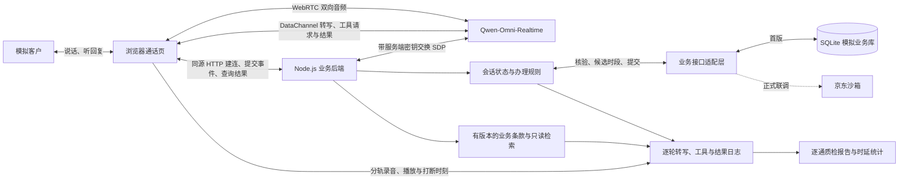

# 智语外呼 · 实时对话与业务办理架构

本文是第一版设计，供前端、语音接入和业务后端联调使用。客户在浏览器里接听模拟外呼，Qwen-Omni-Realtime 主动开场、听取客户发言并作出语音回应。业务后端核对客户身份、保存办理状态、调用业务系统，并向网页返回可核验的结果。

当前用**合成的服务回访预约**说明流程。正式业务以京东发放的场景资料和沙箱接口为准。第一阶段接通百炼托管的 `qwen3.8-omni-flash-realtime`，交付通话、业务问答、结果回写、逐通质检和时延报告。第二阶段固定这版 Qwen 的模型、提示词和工具定义，按批次改进后端的预约确认策略，对核实的严重误办立即处置。

赛题的排名门槛包括连续至少三轮实时语音对话、端到端首字响应时延 P50 ≤ 2 秒、至少一项完整外呼业务闭环和零严重合规违规。下文标为“团队自测”的用例与阈值供开发验收使用。赛题组要求提交能追溯到运行日志、实验记录和前后对比的证据。[赛题简介及规则](https://bjcsaiic.zsyqkj.com/topics/2026/2) · [11 月 20 日评审通知](https://bjcsaiic.zsyqkj.com/notices/6)

## 一通电话经过哪些组件

浏览器与百炼直接传输音频，后端无需逐帧转发语音。浏览器处理麦克风、回声消除和播放，Qwen 处理语音轮次、插话和回复。后端保管长期密钥，同时决定每项业务操作能否执行。网页上的工单号和预约时间取自后端。百炼官方提供了浏览器接入顺序及模型工具事件定义。[WebRTC 接入](https://help.aliyun.com/zh/model-studio/omni-realtime-webrtc-access) · [实时 API 事件](https://help.aliyun.com/zh/model-studio/client-events)

## 从接通到办结

1. **接通。** 浏览器创建业务会话，申请麦克风权限，将 WebRTC 连接描述（SDP）交给后端。后端向百炼换取应答并返回。浏览器收到模型会话配置成功事件后开启麦克风上行，触发 AI 主动介绍身份与来意。
2. **核验并确认需求。** 客户说出模拟服务单尾号，模型请求核验。后端按本轮最终转写与模拟名单核对。核验通过后，客服询问是否需要回访，并介绍业务系统返回的可选时段。
3. **选择和复述。** 客户选择时段，后端保存候选和版本，客服读回完整日期、时间及办理事项。客户提问、犹豫或中途改口时，允许继续交谈。改选时段会产生新版本，并重新复述。
4. **确认并写回。** 客户听完复述，在新一轮明确确认。模型提出提交请求，后端校验会话、确认轮次和候选版本，随后调用模拟工单接口。成功回执包含工单号及实际登记时段，Qwen 据此告知客户，页面同步显示结果。
5. **其他结局。** 客户明确拒绝或表示非本人，记录相应结果并结束。要求人工时登记人工跟进请求。网络中断或主动挂断时，保留已经落库的业务结果；尚未提交的候选按未办结处理。

## Qwen 可以调用的业务工具

| 工具 | 何时调用 | 后端检查及返回 |
|---|---|---|
| `verify_identity` | 客户说完模拟服务单尾号 | 从本轮最终转写核对尾号。通过后返回可用时段及适用规则，核验失败则请客户重试。 |
| `lookup_policy` | 客户询问费用、权益、适用条件或流程 | 只读查询当前场景有效条款，返回答案要点、条款编号和版本；资料不足时返回需澄清或人工核实。此工具在第一阶段加入，随后与其他工具一起冻结用于 RSI 对照。 |
| `propose_slot` | 已核验客户选择或改选时段 | 校验时段，保存候选、版本及来源轮次。返回供客服复述的完整时段。 |
| `confirm_booking` | 客户在后续轮次明确同意已复述的候选 | 校验身份、候选版本、完整复述及本轮确认。检查通过才提交，返回实际工单号。 |
| `close_case` | 客户拒绝、表示非本人或要求人工 | 记录对应的结束原因或跟进请求，关闭继续预约的入口。 |

工具请求携带模型调用编号，应用按会话关联请求产生时的用户轮次及候选版本。模型的自然语言回复和工具请求都不能作为业务回执。首版本地演示将浏览器视为受控终端，正式接沙箱时，订单归属、操作权限、字段校验和写入仍由服务端执行。

## 客户插话时，怎样避免办错

假设客服正在说“为您确认周三上午十点……”，客户插话说“等等，换周四下午”。**停止播报和取消旧确认机会，是两个独立动作。** 语音层处理打断并停止旧回复，业务层在收到新发言开始事件时暂停旧轮次尚未提交的操作，等最终转写再决定下一步。此前缓存的“周三”提交请求即使稍晚抵达，也不能覆盖周四的新选择。

后端按下列规则管理预约：

- **确认必须指向明确的候选。** “周四可能有空”可以记录为待定。复述被打断、客户继续改口或确认指向不明时，再问一次。音频生成结束只说明模型已生成输出；判断是否完整播报还需结合播放和打断事件。无法可靠确认时，重新复述。
- **每通示例预约最多一张工单。** 重复工具请求返回原结果。数据库把业务写入、状态变更和回执放进同一事务。接远端沙箱后采用稳定的业务请求号；提交超时先查办理结果，再决定是否重试。
- **提交前和提交后分别处理。** 提交前可以替换候选。若客户改口时工单已经成功写入，客服先说明当前已登记的结果，再按业务规则改约或登记人工跟进。

## 业务问答与依据

从赛方授权资料整理 FAQ 与条款，每条保存业务范围、适用条件、生效版本、原文位置和经核对的答复要点。通话开始时记录资料版本。查询先按业务范围和生效条件过滤，再按问题和同义说法检索。客服向客户说结论及适用条件，评委可从该轮记录点回原文。多个条款适用且结论不同，先追问缺少的条件；资料没有依据，记录知识缺口并提供人工核实。涉及具体订单状态时，以已核验的业务接口回执为准。问答结束后回到先前的办理步骤。

**团队自测。** 由队员独立标注留出题的标准要点、适用条件和条款编号。覆盖标准问法、同义改写、有条件的权益、过期条款、资料外提问，以及客户在确认前插问费用。逐题核对**实际播出的答复**、引用条款及后台状态。报告正确题数/总题数、有有效依据的事实答复数/事实答复数，并附错题。上述验收用例全部符合标注才通过；“资料外问题”必须承认无法核实，“插问费用”不得触发写单。保留用例编号、录音片段、转写、命中原文位置、知识版本和工具回执。

## 全量质检与复核

以服务端创建的会话清单作为分母。正常办理、拒绝、转人工、断线、无有效发言均生成一份报告；缺失录音或转写时注明原因并列为“证据不足”。报告用会话编号关联双向录音、时间戳转写、检索引用、工具参数和工单结果。先按规则检查身份披露、适用必说话术、禁语和身份核验，再核对实际承诺与条款、成功播报与接口回执。对诱导、歧视、虚假承诺等语义疑例，附轮次及音频起止时间供复核。看板展示规则版本、覆盖数、违规数、待复核数和证据不足数。

区分播前控制与事后发现。办理成功、费用或权益承诺等受控话术，由通话页在相应步骤先关闭自由播报，只播放由有效条款或成功回执生成的核准话术。保留模型生成内容与实际播放记录；进入扬声器的违规内容计为漏拦。直接经 WebRTC 播放的自由对话另按录音复核。

**团队自测。** 跑正常、拒绝、人工、断线以及带标注的缺必说话术、禁语、隐私泄露和无回执报成功样例。逐一对账，要求每个会话编号恰有一份报告，证据不足会话单独列出。对标注样例核对规则编号、结论、录音定位，并检查无违规对照。分别报告必说话术合规率（合规项/适用项）、禁语拦截率（播前成功拦截数/注入的禁语候选数）及误报、漏报；分母为零记为“不适用”。报告齐全、标注样例预期与实际一致、完整通话无严重违规才通过。保留逐通报告和汇总对账表。

## 端到端时延与打断评测

**开发测量。** 以浏览器双向录音的同一时间轴标注客户本轮最后一个有效语音帧和客服首个可辨认回复字的播放起点，两者之差为本地首字时延。打断延迟另测，从客户插话开始到旧回复停止播放。对齐语音检测、检索、工具请求/回执和播放事件，用于定位慢在哪一段。模型首个文本事件和音频首包仅供诊断。设备播放延迟用同步回录样本核对；正式成绩按赛方测量工具及指标定义复测。

**团队自测。** 每通至少三轮，固定模型与策略版本、设备、网络条件，分别覆盖普通应答、知识检索、调用工具、双方同时说话，以及安静、街道、车载、多人背景声。保存每轮起止标记和原始耗时，按全体有效轮次及各场景分别报样本数、P50、P95；本地采用耗时升序第 ⌈p×n⌉ 项。首次主动开场单列；超时、无回复、提前抢话、被打断而无法配对的轮次分项计数并报告失败占比。**赛方硬门槛为端到端首字 P50 ≤ 2 秒。** 自测还须能从录音复算抽取的逐轮结果、查到 P95 和打断延迟及失败明细；P95 与打断延迟按实测报告。留存测量工具版本、设备网络说明、样本清单、逐轮明细和汇总表。

## 第一版怎么验收

| 场景 | 可观察的通过条件 |
|---|---|
| 正常通话 | 浏览器内连续至少三轮语音交互，客服主动开场；核验、选时段、复述和确认后，后台恰好生成一张工单。 |
| 打断并改口 | 客户在播报中改选时段，旧播报停止；旧轮次的提交失效，最终工单只包含新确认的时段。 |
| 未确认、非本人或拒绝 | “我再想想”不会触发写入。非本人或明确拒绝时有对应结局，预约工单数为零。 |
| 工具超时或重试 | 没有成功回执时，客服不能宣称已办好。恢复后重复请求不会生成第二张工单。 |
| 客户插问费用 | 能从播出的答案追溯到适用条款；回答后继续原办理步骤，工单数符合客户确认情况。 |
| 全量质检 | 每个会话编号对应一份可复核报告；抽取一条异常能定位到轮次、录音和后台回执。 |
| 通话时延 | 按赛方口径端到端首字 P50 ≤ 2 秒。逐轮记录可复算，同时提交 P95、打断延迟和失败轮数。 |

联调顺序建议为：先让浏览器与 Qwen 跑通主动开场、三轮对话和打断；再把一项业务从核验接到工单回执；最后用同一套场景验证改口、拒绝、超时和重复提交。已有的 `scenario.mjs` 与 `business.mjs` 是场景和业务逻辑草稿，本文列出的播报确认、版本校验和端到端验收属于后续实现要求。

## 第二阶段：固定 Qwen 的 RSI 设计

首个实验只回答一个问题：**面对相同的转写和工具请求，后端能否更准确地判断客户是否同意当前时段？** 客服刚完整复述周四下午的预约，下面两位客户都说了“行”。即使 Qwen 对两句话都发出 `confirm_booking`，后端也需要作出不同决定。

| 本轮发言 | 正确结果 |
|---|---|
| “行，就按刚才那个时间来。” | 身份已核验、时段唯一且复述完整时，登记周四下午，生成一张工单。 |
| “行是行，我还得问一下家里人。” | 保留候选，记录待定，零张工单。客服可以答复“好的，等您确定后再约”。 |

### 通话中怎样使用策略

每通会话在开始时绑定一个策略版本。浏览器把最终转写、打断与播放事件、工具请求按轮次送到后端。策略读取**本轮完整发言、上一次完整复述的候选版本和当前办理状态**，给出“明确同意当前时段、继续澄清、改选或拒绝”的判断和依据。只有收到提交请求、策略判为明确同意且业务校验全部通过，后端才创建工单。身份核验、复述完整、候选版本匹配、跨轮确认和幂等写入始终由业务后端执行。

**漏调工具时如何恢复。** 后端也订阅每轮最终转写。在等待确认阶段，当客户已经答复、本轮模型响应已结束、仍无对应工具请求时，记录一次漏调疑例。若模型已向客户作出恰当追问，则等待回答；否则在当前播报结束后安排一次固定的澄清问句，例如“您是要确认刚才的周四下午，还是先保留待定？”同一轮只触发一次，客户先开口则取消。转写事件本身不会触发写单。

### 哪些事立即处理，哪些按批改进

| 发生的事 | 当前处置 | 触发策略评估的时机 |
|---|---|---|
| 客户仍在犹豫却已建单，或确认周四却写成周三 | 一例核实即暂停对应策略版本的自动提交路径，查清受影响工单，依业务流程纠正或转人工，记录处置回执。 | 立即复现、补回归用例。修复通过相同验证后可提前发布。 |
| 用户明确同意，客服仍多问一次或最终漏办 | 本通澄清，记录重复追问、最终办理和挂断情况。 | 汇总多个独立会话，一并测试明确同意和附带条件的反例。 |
| 录音与转写不一致，或模型漏调工具 | 当前轮次澄清或人工复核，分别归入语音识别和工具调用问题。 | 单独追踪频率与影响，供对应模块复盘。 |

最终写单处设置**按策略版本或提交路径暂停**的服务端开关。在实际提交边界检查开关，和本地写入串行裁决；已接通且绑定旧策略的会话同样受控。暂停前已经交给沙箱、尚无回执的请求进入对账队列，先按业务请求号查明结果，再决定后续处置。

比赛原型按一批覆盖同意、犹豫、拒绝、改口和打断的场景运行一轮 RSI。真实试点建议每日检查异常、每周评估候选，按确认环节的实际通话量调整周期。样本稀少时跨周累计；同类故障在大量独立通话中骤增时提前评估。看板列明进入确认环节的通话总数，再分列应办理、应暂缓、进入澄清的子集，跟踪误办率、漏办率及澄清后挂断率。

### 通话后怎样产生和验证下一版

1. **构造用例并记录基线。** 给模拟客户指定办理意图和预期工单，再生成多种说法，涵盖同意、犹豫、否定、改口和打断。开发集和留出集按场景及表达来源划分，同一句的改写放在同一侧。每次运行保留用例编号、录音或事件记录、工具请求、策略决定及实际工单。
2. **定位失败。** 先由程序对比预期与实际工单，再由离线分析模型引用具体轮次归因。录音说“不行”而转写成“行”归为识别问题；转写正确但缺少工具请求归为漏调；请求和转写都正确而后端判断错误，才进入本轮确认策略优化。前两类分别跟踪，防止将语音层问题算成策略收益。
3. **生成候选策略。** 离线模型根据开发集里的失败，提出一条通用判断条件及其正反例。例如接受“按刚才的时间来”这类指代，同时检查同一句是否有待定条件。候选以带版本号的配置保存，每轮只调整一个判断条件，允许的动作由后端预先定义。
4. **做对照实验。** 对基线和候选回放同一份 Qwen 输出，重置每次回放的模拟工单。分别报告误办率（应保留待定或拒绝却写单的比例）与漏办率（应提交却未正确办成的比例），单列错误时段和重复写入。回放验证策略判断；另用留出场景跑端到端语音，验证澄清后的后续对话、任务完成率和首字时延 P50/P95。
5. **发布或回滚。** 预先选定本轮目标，例如降低漏办率。留出场景中目标改善、误办率不升、业务校验全部通过且首字时延 P50 ≤ 2 秒后，进入旁路验证。候选与旧版同时判断，由旧版实际办理；核对两者分歧后，将少量新会话切到候选，观察结果再扩大。发现退化时新会话切回旧版，严重误办同时触发提交暂停。保留基线版本、修改理由、样本数、失败明细、两版结果和发布记录。

**团队验收。** 在模拟环境注入一次核实的错时段工单，验证已有通话的下一次提交会被暂停、已提交工单可追溯并记录纠正结果。再回放一批普通澄清样例，检查旁路评估只产生判断记录、每通最多写一张工单，并验证切回旧版后新会话绑定的版本。用同批次的基线与候选结果说明改动收益，同时附上反例、退化项及发布或暂缓的决定。
