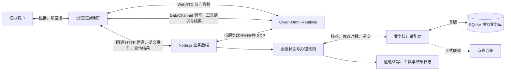

# 智语外呼 · 实时对话与业务办理架构

本文是第一版设计，供前端、语音接入和业务后端联调使用。客户在浏览器里接听模拟外呼，Qwen-Omni-Realtime 主动开场、听取客户发言并作出语音回应。业务后端核对客户身份、保存办理状态、调用业务系统，并向网页返回可核验的结果。

当前用**合成的服务回访预约**说明流程。正式业务以京东发放的场景资料和沙箱接口为准。实时模型沿用百炼托管的 `qwen3.8-omni-flash-realtime`。本版只覆盖实时对话与业务办理。

## 一通电话经过哪些组件

浏览器与百炼直接传输音频，后端无需逐帧转发语音。浏览器处理麦克风、回声消除和播放，Qwen 处理语音轮次、插话和回复。后端保管长期密钥，同时决定每项业务操作能否执行。网页上的工单号和预约时间取自后端。百炼官方提供了浏览器接入顺序及模型工具事件定义。[WebRTC 接入](https://help.aliyun.com/zh/model-studio/omni-realtime-webrtc-access) · [实时 API 事件](https://help.aliyun.com/zh/model-studio/client-events)

## 从接通到办结

1. **接通。** 浏览器创建业务会话，申请麦克风权限，将 WebRTC 连接描述（SDP）交给后端。后端向百炼换取应答并返回。浏览器收到模型会话配置成功事件后开启麦克风上行，触发 AI 主动介绍身份与来意。
2. **核验并确认需求。** 客户说出模拟服务单尾号，模型请求核验。后端按本轮最终转写与模拟名单核对。核验通过后，客服询问是否需要回访，并介绍业务系统返回的可选时段。
3. **选择和复述。** 客户选择时段，后端保存候选和版本，客服读回完整日期、时间及办理事项。客户提问、犹豫或中途改口时，允许继续交谈。改选时段会产生新版本，并重新复述。
4. **确认并写回。** 客户听完复述，在新一轮明确确认。模型提出提交请求，后端校验会话、确认轮次和候选版本，随后调用模拟工单接口。成功回执包含工单号及实际登记时段，Qwen 据此告知客户，页面同步显示结果。
5. **其他结局。** 客户明确拒绝或表示非本人，记录相应结果并结束。要求人工时登记人工跟进请求。网络中断或主动挂断时，保留已经落库的业务结果；尚未提交的候选按未办结处理。

## Qwen 可以调用的四个业务工具

| 工具 | 何时调用 | 后端检查及返回 |
|---|---|---|
| `verify_identity` | 客户说完模拟服务单尾号 | 从本轮最终转写核对尾号。通过后返回可用时段及适用规则，核验失败则请客户重试。 |
| `propose_slot` | 已核验客户选择或改选时段 | 校验时段，保存候选、版本及来源轮次。返回供客服复述的完整时段。 |
| `confirm_booking` | 客户在后续轮次明确同意已复述的候选 | 校验身份、候选版本、完整复述及本轮确认。检查通过才提交，返回实际工单号。 |
| `close_case` | 客户拒绝、表示非本人或要求人工 | 记录对应的结束原因或跟进请求，关闭继续预约的入口。 |

工具请求携带模型调用编号，应用按会话关联请求产生时的用户轮次及候选版本。模型的自然语言回复和工具请求都不能作为业务回执。首版本地演示将浏览器视为受控终端，正式接沙箱时，订单归属、操作权限、字段校验和写入仍由服务端执行。

## 客户插话时，怎样避免办错

假设客服正在说“为您确认周三上午十点……”，客户插话说“等等，换周四下午”。**停止播报和取消旧确认机会，是两个独立动作。** 语音层处理打断并停止旧回复，业务层在收到新发言开始事件时暂停旧轮次尚未提交的操作，等最终转写再决定下一步。此前缓存的“周三”提交请求即使稍晚抵达，也不能覆盖周四的新选择。

后端按下列规则管理预约：

- **确认必须指向明确的候选。** “周四可能有空”可以记录为待定。复述被打断、客户继续改口或确认指向不明时，再问一次。音频生成结束只说明模型已生成输出；判断是否完整播报还需结合播放和打断事件。无法可靠确认时，重新复述。
- **每通示例预约最多一张工单。** 重复工具请求返回原结果。数据库把业务写入、状态变更和回执放进同一事务。接远端沙箱后采用稳定的业务请求号；提交超时先查办理结果，再决定是否重试。
- **提交前和提交后分别处理。** 提交前可以替换候选。若客户改口时工单已经成功写入，客服先说明当前已登记的结果，再按业务规则改约或登记人工跟进。

## 第一版怎么验收

| 场景 | 可观察的通过条件 |
|---|---|
| 正常通话 | 浏览器内连续至少三轮语音交互，客服主动开场；核验、选时段、复述和确认后，后台恰好生成一张工单。 |
| 打断并改口 | 客户在播报中改选时段，旧播报停止；旧轮次的提交失效，最终工单只包含新确认的时段。 |
| 未确认、非本人或拒绝 | “我再想想”不会触发写入。非本人或明确拒绝时有对应结局，预约工单数为零。 |
| 工具超时或重试 | 没有成功回执时，客服不能宣称已办好。恢复后重复请求不会生成第二张工单。 |
| 通话时延 | 按赛方口径测量端到端首字时延，目标 P50 ≤ 2 秒，同时记录 P95。开发阶段保留轮次、语音起止、回复与播放时刻，方便定位延迟。 |

联调顺序建议为：先让浏览器与 Qwen 跑通主动开场、三轮对话和打断；再把一项业务从核验接到工单回执；最后用同一套场景验证改口、拒绝、超时和重复提交。已有的 `scenario.mjs` 与 `business.mjs` 是场景和业务逻辑草稿，本文列出的播报确认、版本校验和端到端验收属于后续实现要求。
